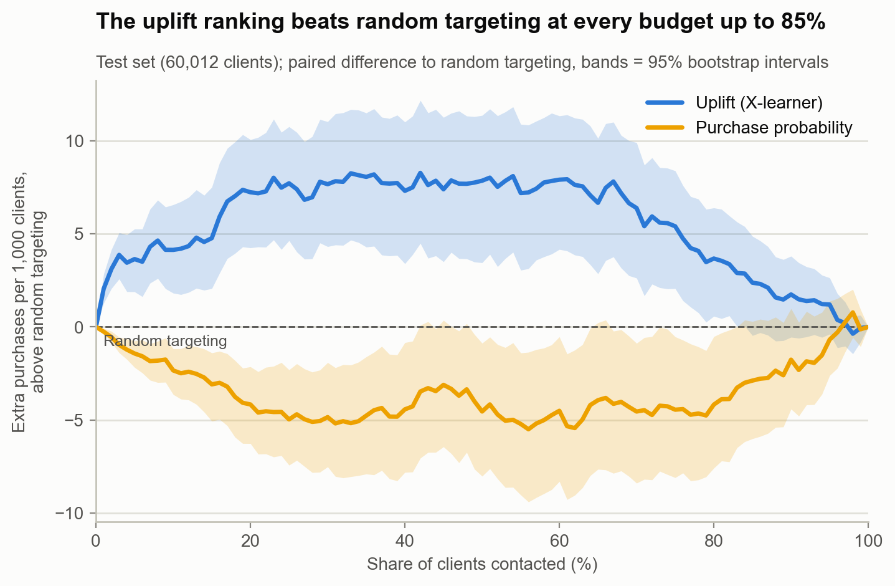

# Whom should the SMS budget reach? Uplift targeting for a retail campaign

A grocery retailer sent an SMS to a random half of 200,000 customers and recorded who made a purchase. This project measures how much the message changed buying, finds which customers it actually moved, and turns that into a decision: whom to text for a given budget, and when texting pays at all. On customers the model never saw, texting the 10% it ranks highest brings about 75 extra buyers per 1,000 messages, against 33 when texting at random and 10 when texting the customers most likely to buy anyway.



## Business question

With a limited marketing budget, which customers should receive an SMS so that it creates the most additional purchases, and when does sending it pay for itself?

## Main results

All effects come from the randomized experiment; intervals are 95%.

| Question | Result |
|---|---|
| Does the SMS work? | It raises the purchase rate by **3.3 percentage points** [2.9, 3.8], 5.5% relative to the control group: about 33 extra purchasing customers per 1,000 messages. |
| Does it work equally for everyone? | No. The effect falls by 0.53 points [0.38, 0.67] for every 10 points of purchase probability: about 5 points among customers unlikely to buy anyway, 1 point among those who almost always buy. |
| Can a model find the customers it moves? | Yes. On the untouched test set (60,012 customers), contacting the top 10% by predicted uplift creates **75 extra purchases per 1,000 messages** [50, 100], against 33 at random and 10 for the likeliest buyers. Its advantage over random targeting is 41 [18, 66] at a 10% budget and stays above zero up to about 85%. |
| Does targeting pay? | It depends on the cost of a message relative to the margin of an extra purchase. Below about 2%, texting almost everyone pays and targeting adds little. Around 3% to 5%, where texting everyone stops paying, targeting gains 2.6 to 6.6 margins per 1,000 customers. At 5%, texting everyone loses 16.8 margins per 1,000 customers while texting the top 9% by uplift earns 2.6 [0.3, 5.2]. |
| What does the model rely on? | Shopping history and age. Shopping history alone gives about 80% of the model's ranking quality; store and time of day habits add nothing. |
| Does it hold elsewhere? | On a second randomized experiment (Criteo online ads), the same methods again find the people the treatment moves, in the same order. There, unlike in X5, targeting the likeliest visitors also works, so the right policy depends on the campaign. |
| How to confirm it? | A follow-up test that randomizes the SMS inside the targeted 10% and inside a random group needs about 9,000 customers per group (about 50,000 under a cautious assumption). |

**Uplift** is the change in a customer's purchase probability caused by the SMS. It is never observed for one person, because each customer either got the message or not, so it is estimated from the randomized groups.

## Data

**X5 RetailHero** (X5 Retail Group, Russian grocery chain, 2019): 400,162 customers, 45.8 million purchase rows from before the campaign, a product table, and 200,039 customers in the SMS experiment with a treatment flag (50/50) and whether they bought during the campaign. The time window of that outcome is not documented. All customers in the experiment had their last purchase within 22 days before the campaign, so results describe recently active customers.

**Criteo uplift v2.1** (Criteo AI Lab): randomized online advertising tests, used only to check the methods on a second dataset; a 10% sample (1.4 million users) is used.

Raw data is not stored in this repository. Only aggregated outputs (figures and the demo tables in `app/data`) are published.

## Limitations

* One campaign of one Russian grocery chain in 2019, among recently active customers. Results are not claimed to carry over to other retailers, countries or messages.
* The outcome is a yes or no purchase in an undocumented window. The data cannot tell whether the SMS created new purchases or moved planned ones earlier, or how much was spent; the value of an extra purchase is an assumption.
* Cost and margin are not in the data. They are parameters, so no absolute profit is claimed.
* The test set has 60,012 customers, so intervals at small budgets are wide; at a cost of 5% of the margin, the profit interval comes close to zero.
* Individual customers cannot be labelled as "persuadable" or "sure thing"; such labels are only predicted tendencies.

## Repository structure

```
├── notebooks/
│   ├── 01_data_audit.ipynb               checks every table, finds and removes a leak of post campaign dates, confirms the randomization
│   ├── 02_customer_base.ipynb            builds 52 customer features, measures how concentrated value is, finds 7 stable segments
│   ├── 03_prediction.ipynb               predicts who buys without an SMS (the "likely buyers" benchmark), with calibration
│   ├── 04_ab_test_analysis.ipynb         measures the SMS effect with intervals, variance reduction, A/A tests, power and subgroups
│   ├── 05_uplift_modelling.ipynb         compares five uplift methods (S, T and X learners, class transformation, uplift forest)
│   ├── 06_targeting_decision.ipynb       compares four policies on the test set by extra purchases and profit, designs a follow-up test
│   └── 07_ablation_and_validation.ipynb  tests which feature groups matter, where the ranking fails, and repeats the methods on Criteo
├── src/x5uplift/        shared code: configuration, features, segments, experiment estimators, uplift models, policy evaluation, plotting
├── scripts/             data pipeline: download, conversion to Parquet, inspection, feature table, Criteo sample
├── app/
│   ├── app.py           Streamlit demo
│   └── data/            aggregated outputs of notebook 06 read by the demo (no customer level data)
├── figures/             figures saved by the notebooks
├── tests/               unit tests for the audit helpers
├── Makefile             one command per pipeline step
└── requirements.txt
```

Each notebook starts with a three sentence summary and one research question, and ends with what was learned, what remains open and the next step.

## Run the demo

The demo reads only the files in `app/data`, so it runs without the raw data.

```
python -m venv .venv
source .venv/bin/activate          # Windows: .venv\Scripts\activate
pip install streamlit pandas matplotlib    # the demo needs only these; requirements.txt has the full analysis stack
streamlit run app/app.py                  # run from the repository root; opens http://localhost:8501
```

Set the share of customers to contact, the size of your customer base, the cost of one SMS and the margin of one extra purchase. The four policies, the suggested budget and the profile of the contacted customers update at once.

## Reproduce the analysis

```
pip install -e .
make download          # X5 files from the scikit-uplift mirror into data/raw (about 650 MB)
                       # products.csv: download the competition archive from ods.ai and place data/products.csv in data/raw
make convert           # CSV to Parquet with DuckDB
make audit             # data checks
make features          # client feature table (52 features, about 10 minutes on 8 GB of RAM)
make criteo            # optional: Criteo 10% sample; download the raw file first (URL in src/x5uplift/config.py)
```

Then run the notebooks in order. Random seeds are fixed (`SEED = 42`). The uplift forest needs `causalml`; on Intel Macs, `numba` is pinned to 0.62 and OpenMP (`libomp`) must be available.

## Sources

* X5 RetailHero uplift modelling dataset: [ods.ai competition page](https://ods.ai/competitions/x5-retailhero-uplift-modeling/data), files via [scikit-uplift](https://www.uplift-modeling.com/en/latest/api/datasets/fetch_x5.html). Terms of use are not stated there; raw data is therefore not redistributed.
* Criteo uplift dataset v2.1: Diemert et al., *A Large Scale Benchmark for Individual Treatment Effect Prediction and Uplift Modeling*, [arXiv:2111.10106](https://arxiv.org/abs/2111.10106); files from the [Hugging Face mirror](https://huggingface.co/datasets/criteo/criteo-uplift), license CC BY-NC-SA 4.0.
* X learner: Künzel et al., *Metalearners for estimating heterogeneous treatment effects using machine learning*, PNAS (2019).
